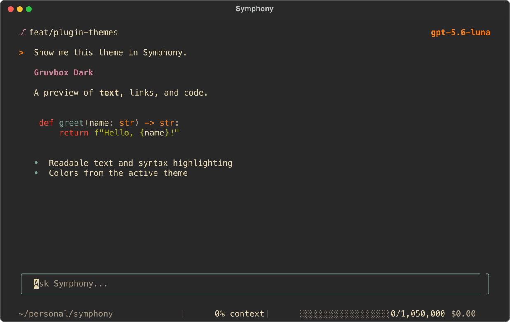
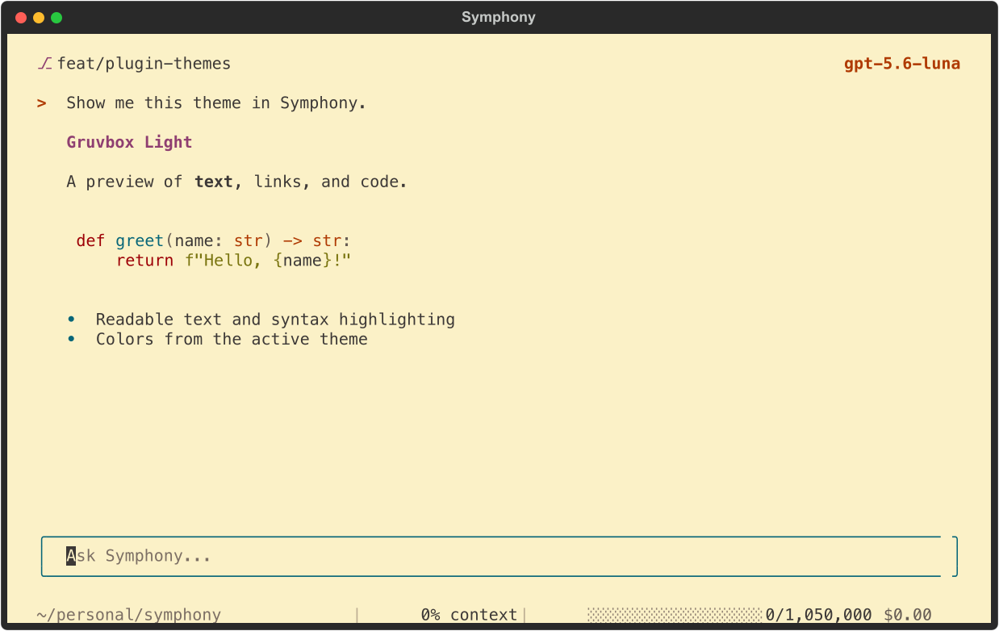
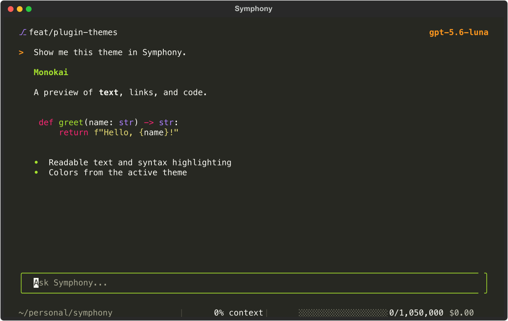
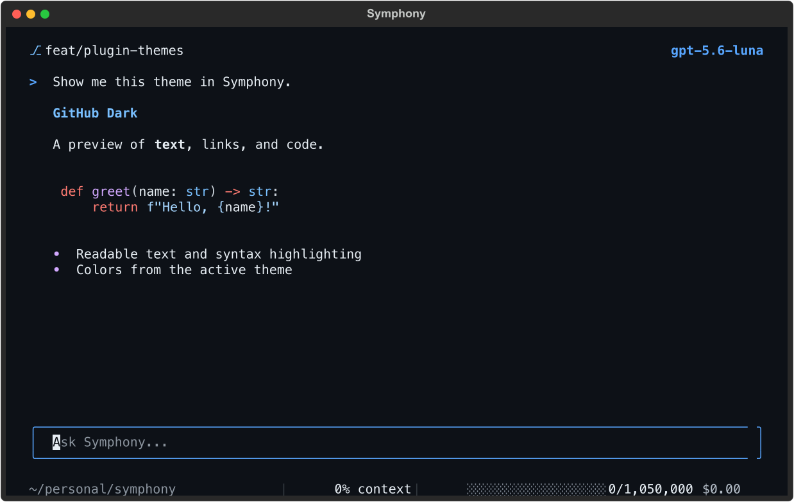
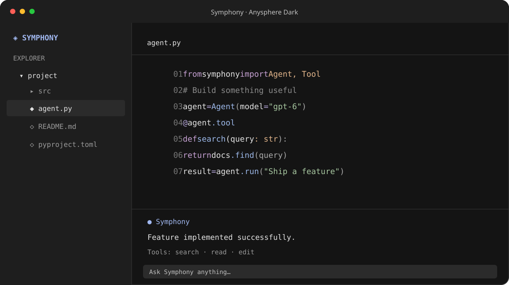
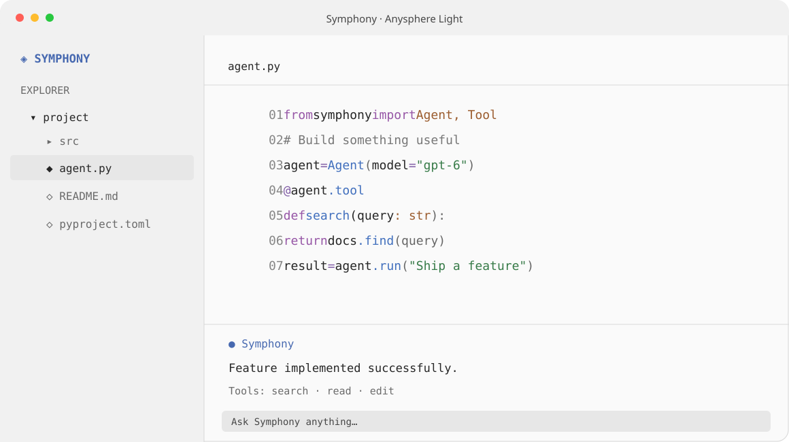
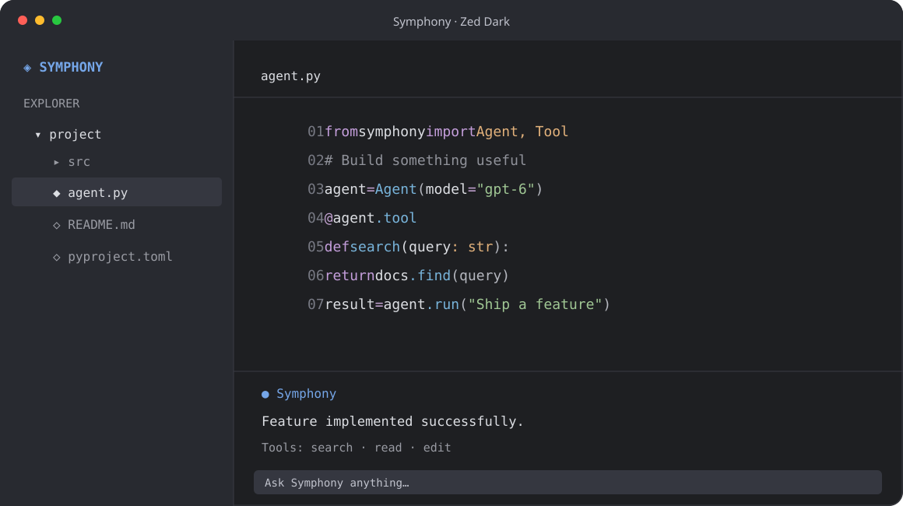

# Symphony Themes

A marketplace of native, data-only color themes for the [Symphony coding agent](https://github.com/Sarthakischauhan/symphony). Theme plugins contain no skills, tools, or executable addon code.

## Install

Theme plugins require Symphony's unreleased `feat/plugin-themes` branch. From that checkout:

```sh
# Register the catalog once; this does not install a theme family.
uv run symphony plugins marketplace add Sarthakischauhan/symphony-themes

# Install only the families you want (each includes its variants).
uv run symphony plugins add gruvbox@symphony-themes
uv run symphony plugins add monokai@symphony-themes
uv run symphony plugins add github@symphony-themes
uv run symphony plugins add anysphere@symphony-themes
uv run symphony plugins add zed@symphony-themes
uv run symphony themes list
uv run symphony
```

Inside Symphony, open `/theme` to preview and select a theme, or use `/theme gruvbox:Gruvbox Dark` directly. Restart a running session after installing a family. Once the feature is released, use `symphony` in place of `uv run symphony`.

The marketplace registration copies its catalog repository into Symphony's cache; it does not make any family available in `/theme` until you install that family. Installing a family copies its theme TOMLs and makes all its variants available; selecting a variant does not download anything further.

```sh
uv run symphony plugins marketplace update symphony-themes
uv run symphony plugins update gruvbox
uv run symphony plugins remove gruvbox
```

If you installed the old single `symphony-themes` plugin, remove it with `uv run symphony plugins remove symphony-themes`, then use the marketplace commands above. An existing `$SYMPHONY_HOME/theme.toml` (or `~/.symphony/theme.toml`) overrides the chosen theme and is never overwritten.

## Theme families

| Plugin | Variants | Palette inspiration |
| --- | --- | --- |
| `gruvbox` | Gruvbox Dark, Gruvbox Light | [Gruvbox](https://github.com/morhetz/gruvbox) |
| `monokai` | Monokai | [Monokai](https://monokai.nl/) |
| `github` | GitHub Dark | [GitHub color themes](https://github.com/primer/github-vscode-theme) |
| `kanagawa` | Kanagawa Wave | [Kanagawa](https://github.com/rebelot/kanagawa.nvim) |
| `one-dark` | One Dark | [Atom One Dark](https://github.com/atom/one-dark-syntax) |
| `symphony` | Symphony Dusk, Symphony Daylight | Original Symphony palettes |
| `anysphere` | Anysphere Dark, Anysphere Light | Minimal Anysphere/Cursor-inspired neutrals |
| `zed` | Zed Dark, Zed Light | Zed editor-inspired palettes |
| `rose-pine` | Rosé Pine Moon | [Rosé Pine](https://rosepinetheme.com/) |
| `catppuccin` | Catppuccin Mocha | [Catppuccin](https://catppuccin.com/) |
| `tokyo-night` | Tokyo Night Storm | [Tokyo Night](https://github.com/enkia/tokyo-night-vscode-theme) |
| `nord` | Nord Polar | [Nord](https://www.nordtheme.com/) |

These are Symphony-native adaptations, not pixel-perfect ports of another application. The existing PNG screenshots below are captured from the Symphony TUI with representative transcript and code content. **New SVG previews are illustrative palette mockups, not live TUI captures.**

<details>
<summary>Gruvbox Dark</summary>


</details>

<details>
<summary>Gruvbox Light</summary>


</details>

<details>
<summary>Monokai</summary>


</details>

<details>
<summary>GitHub Dark</summary>


</details>

<details>
<summary>Kanagawa Wave</summary>


</details>

<details>
<summary>One Dark</summary>


</details>

<details>
<summary>Symphony Dusk</summary>


</details>

<details>
<summary>Symphony Daylight</summary>


</details>

## New theme previews

<details>
<summary>Anysphere Dark (illustrative palette preview)</summary>


</details>

<details>
<summary>Anysphere Light (illustrative palette preview)</summary>


</details>

<details>
<summary>Zed Dark (illustrative palette preview)</summary>


</details>

<details>
<summary>Zed Light (illustrative palette preview)</summary>


</details>

<details>
<summary>Rosé Pine Moon (illustrative palette preview)</summary>


</details>

<details>
<summary>Catppuccin Mocha (illustrative palette preview)</summary>


</details>

<details>
<summary>Tokyo Night Storm (illustrative palette preview)</summary>


</details>

<details>
<summary>Nord Polar (illustrative palette preview)</summary>


</details>

## Contribute

Each family under `plugins/` has a `plugin.json` and a `themes/` directory. Add a uniquely named TOML with `name`, `base` (`dark` or `light`), and a `[colors]` table. Existing files show all supported tokens. Specify every token for predictable colors; missing tokens fall back to the selected base palette. Add new families to `.agents/plugins/marketplace.json`. Only theme data is read; CSS and executable code are not loaded from theme files.

Some Symphony widgets still use fixed colors, and transcript text already rendered before switching themes may keep its old colors. Contributions must be your own or include clear licensing and attribution.
